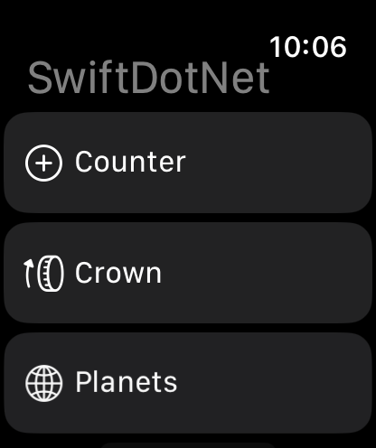
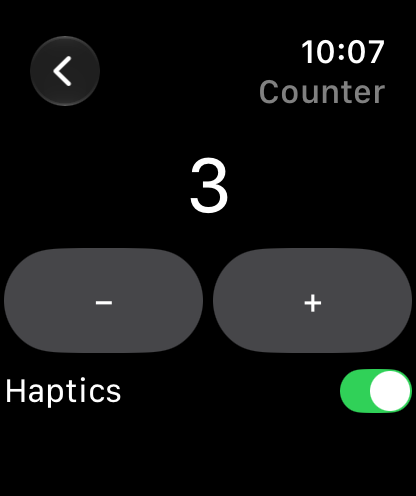
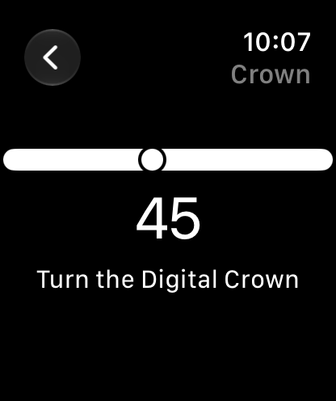
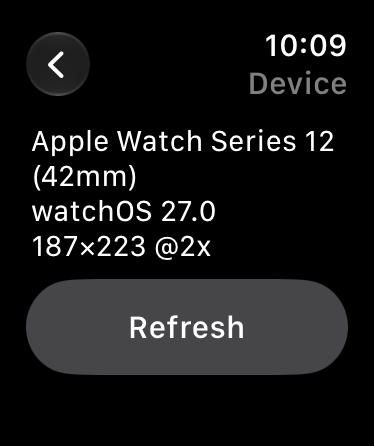

# Apple Watch — watchOS (SwiftUI)

Write an Apple Watch app with the same C# DSL as every other head, and it renders as **real watchOS SwiftUI**
through the same interpreter the iOS/macOS/tvOS heads use
([`Bridge.swift`](../../native/SwiftDotNetBridge/Sources/SwiftDotNetBridge/Bridge.swift)). There is no watchOS
runtime in .NET, so the C# runs on the watch as **NativeAOT** code compiled with the iOS runtime packs and
restamped to watchOS.

- **Verified:** watchOS 27.0 simulator (Apple Watch Series 12, 42mm and 46mm), Xcode 26.6 / watchOS SDK 26.5 —
  NativeAOT build and live mode. See [Status](#status).
- **Route:** native shim, like the other Apple heads — but **inverted**: the Swift app owns the process and calls
  into .NET, rather than .NET owning it and P/Invoking Swift.
- **Package:** [`src/SwiftDotNet.Watch`](../../src/SwiftDotNet.Watch) (managed host + services) and its
  [`sdk/`](../../src/SwiftDotNet.Watch/sdk) (MSBuild pipeline, Swift host, tools). Adapted from the Shiny.Wearables
  prototype; design record in [`plans/watchos-plan.md`](../../plans/watchos-plan.md).

 
 

## How to use it

A watch head is a plain `net10.0` project that imports the SDK and returns the usual composition root —
[`sample/SampleApp.Watch`](../../sample/SampleApp.Watch):

```xml
<Project Sdk="Microsoft.NET.Sdk">
  <Import Project="..\..\src\SwiftDotNet.Watch\sdk\SwiftDotNet.Watch.props" />
  <PropertyGroup>
    <TargetFramework>net10.0</TargetFramework>
    <RootNamespace>MyCompany.Watch</RootNamespace>
    <ApplicationTitle>My Watch App</ApplicationTitle>
    <ApplicationId>com.mycompany.watch</ApplicationId>
  </PropertyGroup>
  <ItemGroup>
    <ProjectReference Include="..\..\src\SwiftDotNet.Watch\SwiftDotNet.Watch.csproj" />
    <WatchSwift Include="Native/*.swift" />   <!-- optional: your own SwiftUI / native services -->
  </ItemGroup>
  <Import Project="..\..\src\SwiftDotNet.Watch\sdk\SwiftDotNet.Watch.targets" />
</Project>
```

```csharp
public static class SwiftProgram          // the SDK's generated bootstrap calls this
{
    public static SwiftDotNetApp CreateSwiftApp()
    {
        var builder = SwiftDotNetApp.CreateBuilder();
        builder.UseSwiftApp(_ => new WatchRootView());   // explicit factory: NativeAOT-clean
        return builder.Build();
    }
}

public sealed class WatchRootView : View
{
    readonly State<int> _count = State(0);
    readonly State<double> _crown = State(40.0);

    protected override void OnCreated() => _count.Value = Preferences.Get("count", 0);

    public override View Body =>
        new NavigationStack(
            new List(
                new NavigationLink(new Label("Counter", "plus.circle"),
                    new VStack(
                        new Text($"{_count.Value}").Font(Font.LargeTitle),
                        new Button("+", () => { _count.Value++; Haptics.Play(HapticType.Click); }))),
                new NavigationLink(new Label("Crown", "digitalcrown.arrow.clockwise"),
                    new Gauge(_crown.Value, 0, 100, "Crown")
                        .DigitalCrownRotation(_crown.Value, v => _crown.Value = v, from: 0, through: 100, by: 1)))
            .NavigationTitle("My App"));
}
```

| Command | What happens |
|---|---|
| `dotnet run` (Debug) | **Live mode:** C# runs on the Mac under CoreCLR (any debugger, Hot Reload); a thin shell on the watch simulator renders it |
| `dotnet run -c Release` | NativeAOT build, installed and launched on a watch simulator, stdout streamed |
| `dotnet build -p:WatchTarget=device -p:CodesignKey=… -p:CodesignProvision=…` | A real watch (arm64, watchOS 26+) |

Properties: `WatchTarget` (`live` / `simulator` / `device` — set it on the command line or before the props
import), `WatchSimulator` (name or UDID; default: a booted watch, else the newest), `WatchMinimumOSVersion`,
`WatchLivePort`, `SwiftDotNetWatchAppFactory` (default `SwiftProgram.CreateSwiftApp`), `CodesignKey` /
`CodesignProvision` / `CodesignEntitlements`. `Info.plist`, `Entitlements.plist` and `Assets.xcassets` in the
project folder are picked up automatically; `<WatchResource>` items are copied into the bundle.

## How it works

```
 C# app ──► NativeAOT (iossimulator/ios-arm64 packs) ──► static lib (.a)
                                                           │  retarget-macho.py: LC_BUILD_VERSION iOS ➜ watchOS
 Bridge.swift (shared renderer) + watch host + your Swift ─┴─ swiftc ──► YourApp.app ──► simctl / devicectl
```

1. **Build:** `dotnet build` compiles a normal library, then an inner NativeAOT publish produces a static
   library with the **iOS** runtime packs.
2. **Retarget:** those objects are arm64 code against `libSystem` — what watchOS uses — and only the Mach-O
   platform stamp differs. [`retarget-macho.py`](../../src/SwiftDotNet.Watch/sdk/tools/retarget-macho.py)
   rewrites it so `ld` will link them.
3. **Link:** the shared `Bridge.swift`, the [watch host](../../src/SwiftDotNet.Watch/sdk/swift) and your
   `<WatchSwift>` files are compiled for watchOS and linked with the retargeted runtime; the build writes
   `Info.plist`, compiles assets, creates a dSYM and signs.
4. **Run:** the Swift `@main` app calls `swiftdotnet_watch_bootstrap` (generated into your assembly), which
   builds `SwiftProgram.CreateSwiftApp()` and runs the ordinary `SwiftApp` loop. Patches go to
   `swiftdotnet_render`; UI events come back through `swiftdotnet_watch_event`.

The C ABI ([`swiftdotnet_watch.h`](../../src/SwiftDotNet.Watch/sdk/swift/swiftdotnet_watch.h)):

| Symbol | Direction | Role |
|---|---|---|
| `swiftdotnet_watch_register_callbacks` | Swift → .NET | hands .NET `render`, `request_drain`, `log`, `call` function pointers |
| `swiftdotnet_watch_bootstrap` | Swift → .NET | generated per app; starts the host with your `SwiftDotNetApp` |
| `swiftdotnet_watch_event(id, value)` | Swift → .NET | a UI event from the renderer (tap, text, toggle, crown) — rendered before it returns |
| `swiftdotnet_watch_native_event(name, json)` | Swift → .NET | service callbacks (`http.response`, `phone.message`, …) |
| `swiftdotnet_watch_phase(n)` | Swift → .NET | scene phase → `WatchHost.PhaseChanged` |
| `swiftdotnet_watch_drain()` | Swift → .NET | runs posted main-thread work (coalesced renders, `await` continuations) |

**Threading.** `WatchHost` installs a main-thread `SynchronizationContext` before `SwiftApp.Run` captures it, so
a `State<T>` write from a timer or an `await` posts a coalesced render and Swift drains it on the main queue. An
`await` inside a handler resumes on the watch's main thread; no marshaling needed.

## Services

All in `SwiftDotNet.Watch`, all riding one synchronous `WatchHost.CallNative(op, args)` channel:

| API | Backed by | Notes |
|---|---|---|
| `Haptics.Play(HapticType)` | `WKInterfaceDevice.play` | |
| `WatchDevice.Current` | `WKInterfaceDevice` | Use this, not `OperatingSystem`/`RuntimeInformation` (they report iOS) |
| `Preferences.Get/Set/Remove` | `UserDefaults` | string / int / double / bool |
| `WatchHttp.CreateClient()` / `WatchHttpMessageHandler` | `URLSession` | **Use this on hardware** — BSD sockets are restricted on real watches, so the default handler only works in the simulator |
| `PhoneConnection` | `WCSession` | `SendMessage`, `UpdateApplicationContext`, `TransferUserInfo`, `MessageReceived`. **Untested** against a paired phone |
| `WatchHost.CallNative("op", args)` | your Swift | register with `registry.service("op") { args in … }` inside `func swiftDotNetWatchConfigure(_ registry: SwiftDotNetWatchRegistry)` in a `<WatchSwift>` file; `registry.renderer(type) { … }` renders your `CustomView`s |

## Live mode (Debug default)

`dotnet run` in Debug builds an ordinary Mac executable plus a **shell** app for the watch simulator that contains
no .NET — just the renderer and the host. The executable listens on a per-app loopback port, installs and
launches the shell, and the shell connects (retrying every second, so either side can restart). Frames are a
4-byte big-endian length + JSON, and carry exactly what the C ABI carries — `render` {patch}, `event`,
`nativeEvent`, `phase`, `call`/`result` — so native services (haptics, prefs, URLSession) still run **on the
watch**. A reconnecting shell gets the whole tree again. `dotnet watch` hot-reloads `Body` edits with `State`
kept (the Core `HotReload` handler calls `SwiftApp.Invalidate()`). `SWIFTDOTNET_WATCH_NOLAUNCH=1` skips the
launch; `SWIFTDOTNET_WATCH_TRACE=1` logs events, native calls and patch sizes.

Live mode is simulator-only (real watches restrict raw sockets), runs CoreCLR rather than NativeAOT (the AOT and
trim analyzers stay on, but test the Release build before shipping), and cannot reach a physical watch.

## Per-control behaviour on watchOS

The watch compiles the shared interpreter with `#if os(watchOS)` fallbacks, mostly the ones tvOS already has:

| DSL | watchOS |
|---|---|
| `TextEditor` | `TextField` (system text-input sheet) |
| `ColorPicker` | label + swatch (read-only) |
| `DisclosureGroup` | header button + conditional children |
| `Menu` | items shown inline under the label |
| `TextField` / `SecureField` | no `.roundedBorder` style |
| paged `TabView` | `.page` style without the index background |
| `.OnMagnify` | no-op (no pinch on watchOS) |
| `MauiView` | placeholder (no `UIView` on watchOS) |
| `WebView` | "unavailable" placeholder (no WebKit) |
| `.DigitalCrownRotation` | **real Digital Crown** — see [the modifier](../modifiers-gestures-animation.md#digital-crown-rotation) |

## Gotchas

- **Put the SDK props import at the top of the project body**, and set `WatchTarget` on the command line (or
  before that import): it decides `RuntimeIdentifier`/`PublishAot`/`OutputType` when the props evaluate.
- **The generated bootstrap resolves `SwiftProgram` in your `RootNamespace`.** If your composition root lives
  elsewhere, set `SwiftDotNetWatchAppFactory` to a fully-qualified static method returning `SwiftDotNetApp`.
- **Use an explicit root factory** (`UseSwiftApp(_ => new Root())`) — it's NativeAOT-clean.
- **`OnCreated` can call native services** (the host attaches before the root is created).
- **Globalization is invariant** (no ICU on the watch); live mode matches.
- **App icon:** `actool` needs a watchOS simulator runtime matching the SDK version; if it's missing the build warns
  and skips the icon.
- **The Swift module is always `SwiftDotNetWatchApp`**, whatever your assembly is called (Swift module names can't
  contain dots).

## Status

| Area | Status |
|---|---|
| NativeAOT build → watch simulator | ✅ Verified — 0 warnings; runs on the watchOS 27.0 simulator |
| Navigation push/pop, buttons, list, `State` round-trip | ✅ Verified on the simulator (driven through the Simulator window); `Toggle` rendered but not toggled |
| Digital Crown | ✅ Verified on the simulator (scroll-wheel input: 40 → 45) |
| `Preferences` (incl. from `OnCreated`, across relaunch), `WatchDevice` | ✅ Verified on the simulator |
| `WatchHttp` over URLSession, `await` on the main thread | ✅ Verified on the simulator (headless smoke: HTTP 200) |
| Live mode | ✅ Shell connects and renders on the simulator; 🧪 interaction covered by an end-to-end socket test with a fake shell — **not** driven through the real shell's UI |
| Hot Reload in live mode | 🧩 Wired (Core `HotReload` → `SwiftApp.Invalidate()` → full tree to the shell) — not exercised with `dotnet watch` |
| `Haptics` | 🧩 Called on the simulator (no Taptic Engine to feel) |
| `PhoneConnection` | 🧩 Built; never run against a paired phone |
| Physical watch (`WatchTarget=device`) | 🧩 Pipeline ported from a prototype whose device *link* was verified; **not built or run here** |
| TestFlight / App Store | ❌ Unknown — acceptance of restamped iOS objects is unproven |
| Complications / Smart Stack | ❌ Not built — would extend [Live Surfaces](../live-surfaces.md)' widget work |

Automated coverage: [`WatchTests`](../../tests/SwiftDotNet.Tests/WatchTests.cs) (12 tests) — the crown wire
contract, the host loop and services through a fake native platform, and the live protocol over a real socket.

## Caveats — read before betting on this

- **Not an Apple- or Microsoft-supported toolchain.** Restamping iOS-built objects as watchOS works because the
  ABI is identical, but the runtime was never tested on watchOS by its authors.
- **Real watches: arm64 only, watchOS 26+.** NativeAOT can't target `arm64_32` (the ILP32 ABI older watches use),
  and 64-bit watch apps need watchOS 26, so the SDK enforces `WatchMinimumOSVersion >= 26.0` for devices.
- **App Store acceptance is unproven**, and **device install/run is untested**.
- **Build host:** macOS with Xcode only.

## See also

- [Apple — iOS / macOS / tvOS](apple.md) — the shared interpreter and its `#if` fallbacks
- [Modifiers → Digital Crown rotation](../modifiers-gestures-animation.md#digital-crown-rotation)
- [Hosting & DI](../hosting-and-di.md) — `SwiftProgram.CreateSwiftApp()`
- [`plans/watchos-plan.md`](../../plans/watchos-plan.md) — decisions, rejected alternatives, open questions
