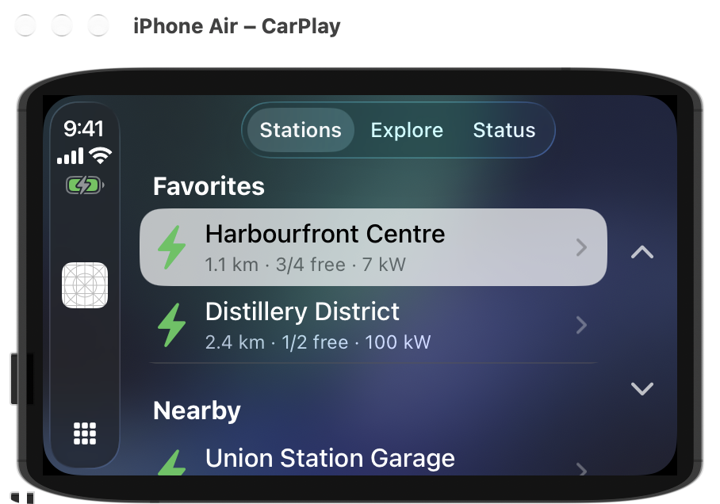
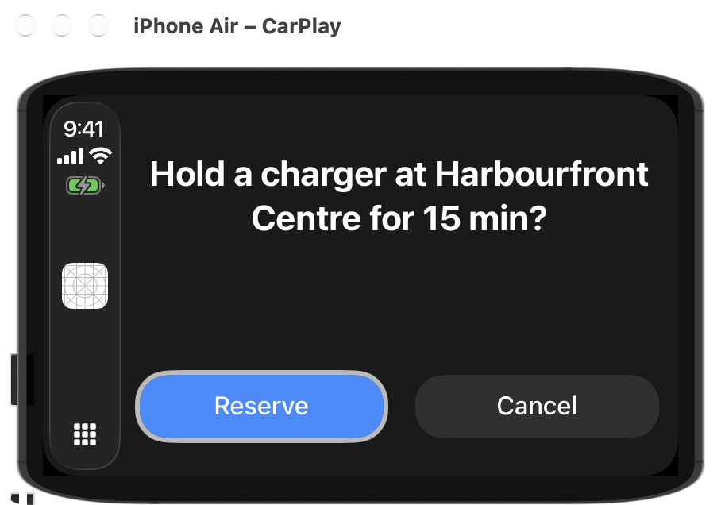
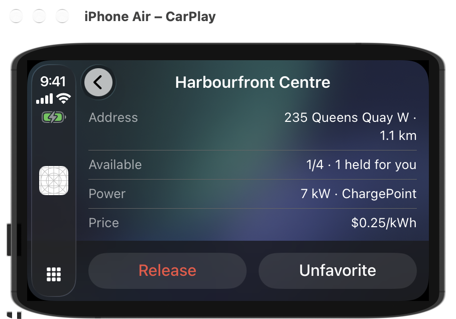
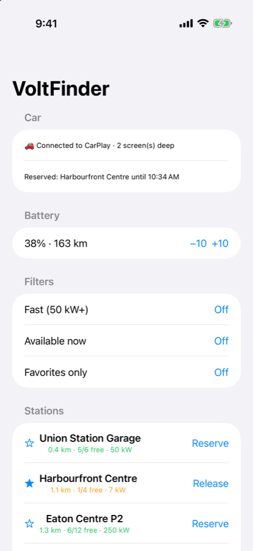

# CarPlay & Android Auto

The `SwiftDotNet.Car` companions put your app on a car's head unit: **CarPlay** on iOS, and **Android Auto**
(and Android Automotive OS) on Android, from one C# model. You describe each car screen as an immutable
template built from state; the library checks it against the content limits and category rules both platforms
enforce, then maps it to `CPTemplate`s or `androidx.car.app` templates and updates them in place when state
changes.

There is no SwiftUI analog. CarPlay's closest native equivalent is `CPTemplateApplicationScene` +
`CPInterfaceController`; Android's is the Car App Library's `CarAppService` / `Session` / `Screen`.

```csharp
public sealed class StationsScreen(StationService stations) : CarScreen
{
    public override CarTemplate Build() => CarListTemplate.Create("Stations",
        stations.Nearby().Select(s => new CarListItem
        {
            Title = s.Name,
            Detail = $"{s.Available}/{s.Total} free",
            Image = CarImage.Symbol("bolt.fill", "ic_bolt").WithTint(Color.Green),
            Accessory = CarAccessory.Disclosure,
            OnSelect = () => Navigator.Push(new StationDetailScreen(stations, s)),
        }));

    protected override void OnAttached() => stations.Changed += OnChanged;
    protected override void OnDetached() => stations.Changed -= OnChanged;
    void OnChanged(object? s, EventArgs e) => Invalidate();   // safe from any thread
}
```

| CarPlay (iOS 26.5 simulator) | | |
|---|---|---|
|  |  |  |

The phone UI (ordinary SwiftDotNet views) reads the same `StationService` and shows the connection:


Adapted from the Shiny.Auto prototype; the plan, with the design decisions and what changed from the draft,
is [`plans/car-backends-plan.md`](../plans/car-backends-plan.md).

## Why this is not another backend

Every backend assumes our process owns the renderer and can push [`View`](../src/SwiftDotNet/Core/View.cs)
patches. A head unit won't let us draw. Both platforms offer a fixed catalogue of screen shapes, a screen stack,
and a hard cap on how much each shape may hold, all enforced to limit driver distraction. A `VStack` has no
equivalent. So the car layer has **its own vocabulary**, as [Live Surfaces](live-surfaces.md) does, and an
unsupported shape is a type you can't construct, not content that silently disappears on a head unit you can't
see.

It is also not a `View` tree for a second reason: [`SwiftApp`](../src/SwiftDotNet/Core/SwiftApp.cs) holds one
root per process, and the phone UI owns it. Car screens therefore re-render through their own navigator
(`Build()` + `Invalidate()`, MVU style) rather than through `State<T>`.

## How to use it

### 1. Register the car app next to the phone UI

```csharp
public static SwiftDotNetApp CreateSwiftApp(Action<SwiftDotNetAppBuilder>? platform = null)
{
    var builder = SwiftDotNetApp.CreateBuilder();
    builder.UseSwiftApp(sp => new PhoneView(sp.GetRequiredService<StationService>(), sp.GetRequiredService<ICarConnection>()));
    builder.UseCar<VoltCarApp>(o =>
    {
        o.Category = CarAppCategory.Charging;   // must match the entitlement / intent-filter category
        o.Log = m => Console.WriteLine(m);      // truncations and renderer fallbacks
    });
    builder.Services.AddSingleton<StationService>();
    platform?.Invoke(builder);
    return builder.Build();
}

public sealed class VoltCarApp(StationService stations) : CarApp
{
    public override CarScreen CreateRootScreen(IServiceProvider services) => new RootScreen(stations);
}
```

The phone head and the car entry points get **the same container**
([`SwiftDotNetApp.GetOrCreate`](../src/SwiftDotNet/Core/Hosting/SwiftDotNetApp.cs)). Whichever starts first
builds the app, so a singleton the phone changes is the same instance the car screen reads. Inject
`ICarConnection` on the phone side to show connection state, the platform, and the car's navigator.

### 2. The iOS head

```csharp
[Register("AppDelegate")]
public sealed class AppDelegate : SwiftDotNetAppDelegate
{
    protected override SwiftDotNetApp CreateSwiftApp() => SwiftProgram.CreateSwiftApp(b => b.UseCarPlay());
}
```

```xml
<ItemGroup Condition="'$(TargetPlatformIdentifier)' == 'ios'">
  <ProjectReference Include="…/src/SwiftDotNet.Car.Apple/SwiftDotNet.Car.Apple.csproj" />
</ItemGroup>
<Import Project="…/src/SwiftDotNet.Car.Apple/SwiftDotNetCar.targets" />
<PropertyGroup Condition="$(TargetFramework.EndsWith('-ios'))">
  <CodesignEntitlements>Platforms/iOS/Entitlements.plist</CodesignEntitlements>  <!-- e.g. com.apple.developer.carplay-charging -->
</PropertyGroup>
```

`SwiftDotNetCar.targets` merges a scene manifest into Info.plist. The phone window then comes from
[`SwiftDotNetSceneDelegate`](../src/SwiftDotNet/Platforms/iOS/SwiftDotNetSceneDelegate.cs) and the car from
[`SwiftDotNetCarPlaySceneDelegate`](../src/SwiftDotNet.Car.Apple/SwiftDotNetCarPlaySceneDelegate.cs).
`SwiftDotNetAppDelegate` detects the manifest and leaves window creation to the scene.

### 3. The Android head

```csharp
[Service(Exported = true, Name = "com.myapp.CarService")]
[IntentFilter(["androidx.car.app.CarAppService"], Categories = ["androidx.car.app.category.CHARGING"])]
public class CarService : SwiftDotNetCarAppService
{
    protected override SwiftDotNetApp CreateSwiftApp() => SwiftProgram.CreateSwiftApp();
}
```

Reference `SwiftDotNet.Car.Android`. The `com.google.android.gms.car.application` metadata and
`@xml/automotive_app_desc` ship in the library. `CarMapTemplate` also needs the `androidx.car.app.MAP_TEMPLATES`
and `androidx.car.app.ACCESS_SURFACE` permissions. Give every icon a vector drawable:
`CarImage.Symbol("bolt.fill", "ic_bolt")`. Without the second argument, the Android name is derived from the
SF Symbol (`bolt.car` → `bolt_car`).

### 4. Navigate

`Navigator.Push` / `Pop` / `PopToRoot`, plus `Present(CarAlertTemplate | CarActionSheetTemplate)` and `Dismiss`.
Tapping any action on a presented modal dismisses it **before** your handler runs, on both platforms. The
platform's own Back (the CarPlay back button, the Android host back) is reported to the navigator, so its
`Stack` stays true.

## Template mapping

| `SwiftDotNet.Car` | CarPlay | Android Auto |
|---|---|---|
| `CarListTemplate` (sections, `CarListItem`, `CarToggleItem`) | `CPListTemplate` (the toggle is a checkmark accessory — CarPlay has no switch) | `ListTemplate`, `Row`, `Toggle` |
| `CarGridTemplate` | `CPGridTemplate` | `GridTemplate` |
| `CarTabsTemplate` (list / grid / info content) | `CPTabBarTemplate` | `TabTemplate` (car API 6+) |
| `CarInfoTemplate` | `CPInformationTemplate` | `PaneTemplate` |
| `CarAlertTemplate` / `CarActionSheetTemplate` | `CPAlertTemplate` / `CPActionSheetTemplate` (presented) | `MessageTemplate` (pushed as a screen) |
| `CarSearchTemplate` | `CPSearchTemplate` | `SearchTemplate` |
| `CarPointOfInterestTemplate` | `CPPointOfInterestTemplate` (the host shows the detail card) | `PlaceListMapTemplate` (tapping a row calls `OnSelect`, or presents an action sheet with the same two actions) |
| `CarMapTemplate` (app-drawn) | `CPMapTemplate` + `CPWindow`; overlay content becomes a bar button that pushes it | `MapWithContentTemplate` + `SurfaceCallback` (car API 7+) |
| `CarAction.Style` Primary / Destructive / Cancel | Confirm / Destructive / Cancel | `FLAG_PRIMARY` / red background |

**In-place updates.** An invalidated screen updates its native template where the platform allows:
- CarPlay:
  - lists → `UpdateSections`
  - grids → `UpdateGridButtons`
  - info panes → property setters
  - tabs → each child updated in place
  - points of interest → `SetPointsOfInterest`
  - map → redraw
- Android: `Screen.Invalidate()` makes the host call `OnGetTemplate` again.

A change of template type replaces the top screen. A covered screen is rebuilt when it next appears.

**The map surface** is drawn through the same [`ICanvas`](../src/SwiftDotNet.Graphics/ICanvas.cs) seam the
self-drawing engine uses:
- CarPlay: [`AppleCanvas`](../src/SwiftDotNet.Graphics.Apple/AppleCanvas.cs), over CoreGraphics
- Android Auto: [`AndroidCanvas`](../src/SwiftDotNet.Graphics.Android/AndroidCanvas.cs)

One `Draw(CarMapDrawContext)` paints both. Pan and zoom arrive as `OnPan` / `OnZoom` in device-independent units.

## Limits and category rules

`CarLimits.Portable` (the default) takes the **stricter** of the two platforms' driving-mode limits, so the
same model renders the same way on both:

| Limit | Portable | Why |
|---|---|---|
| List items (all sections) | 6 | Android Auto `ConstraintManager` list limit while driving |
| Grid items | 6 | Android Auto; CarPlay allows 8 |
| Tabs | 2–4 | Android `TabTemplate` |
| Info items / actions | 4 / 2 | Android `Pane`; CarPlay allows 10 / 3 |
| Modal actions | 2 | `MessageTemplate`; CarPlay alerts |
| Points of interest | 6 | Android place list; CarPlay allows 12 |
| Header actions / map buttons | 2 / 4 | |
| Stack depth | 5 | CarPlay hierarchy depth, Android task step limit |

- `CarOptions.ConstraintMode = Truncate` (default) drops the excess and logs `constraint exceeded: … Truncated.`;
  `Throw` raises `CarConstraintException`. Depth overflow always throws.
- Structural errors (a modal built by a screen, POI content in a tab, a grid item without an image) always throw
  `CarTemplateException`.
- `LimitsSource = Platform` uses what the head unit reports (`CPListTemplate.MaximumItemCount`,
  `ConstraintManager.GetContentLimit`). Output may then differ between platforms.

**Categories.** Each platform allows only some templates per app category, and CarPlay **crashes** the app when
a disallowed one is pushed (`NSInvalidArgumentException: Unsupported object … passed to pushTemplate`). With
`CarOptions.Category` set, disallowed templates are rejected up front, and a screen can adapt with
`Navigator.Supports<T>()`:

| Template | CarPlay | Android Auto |
|---|---|---|
| `CarPointOfInterestTemplate` | POI categories (charging, parking, fueling, food) | POI categories, not navigation |
| `CarSearchTemplate` | navigation only | allowed |
| `CarMapTemplate` | navigation only (`carplay-maps`) | POI and navigation |

## Gotchas

- **`UseCarPlay()` is load-bearing.** Only Info.plist names the CarPlay scene delegate, and a plist string is not
  a reference. Without a C# call into `SwiftDotNet.Car.Apple` the build leaves the assembly out, and
  `CarPlay.framework` with it. The app's icon still appears on the CarPlay screen but opens to nothing, and the
  log shows `unrealized specification class 'CPUITemplateApplicationSceneSpecification'`.
- **A scene manifest switches the whole app to scenes.** That's why the phone window moves to
  `SwiftDotNetSceneDelegate`. If your app already declares `UIApplicationSceneManifest`, set
  `SwiftDotNetCarAddSceneManifest=false` and copy the CarPlay entry from
  [`SwiftDotNetCar.Scene.plist`](../src/SwiftDotNet.Car.Apple/SwiftDotNetCar.Scene.plist).
- **Android starts the car service without an activity.** `SwiftDotNetCarAppService` builds the app itself, via
  `GetOrCreate`, so the phone activity opened later reuses it. As a consequence, an Android activity recreated on
  rotation now reattaches the same root view instead of building a second app.
- **Name clashes on Android.** Put `using` directives *inside* the namespace in files that also import
  `Android.Widget` / `AndroidX.Car.App.Model` (both have `Button`/`Toggle`/`Row`…). Otherwise the DSL's types
  and the platform's are ambiguous.
- **CarPlay tints are baked.** CarPlay re-renders images in its own process and drops a symbol's tint, so tinted
  images are rasterized with the colour applied. Tints are DSL colour tokens resolved by
  [`CarColors`](../src/SwiftDotNet.Car/CarImage.cs) with the engine's own table.
- **Android needs a distance on non-browsable place rows.** Set `CarPointOfInterest.DistanceKm`, or the row is
  made browsable.
- **Entitlements are not ours to grant.** Apple grants **one** CarPlay category per app; the simulator accepts
  the entitlement without approval, but a device build needs a profile that includes it. Android Auto needs no
  entitlement, but Play reviews car apps against the car-app quality guidelines. An app that fits no category
  cannot ship a car UI, however it's written.

## Per-platform notes

| | CarPlay | Android Auto |
|---|---|---|
| Entry point | `SwiftDotNetCarPlaySceneDelegate` (scene manifest) | your `SwiftDotNetCarAppService` subclass |
| Shim | none — pure C# over the `CarPlay` bindings (route 2, a first for an Apple target) | none — pure C# over `Xamarin.AndroidX.Car.App.App` 1.7.0.1 |
| Map taps | **not delivered** (CarPlay gives the base view no taps); `OnTap` is Android-only | `OnClick` → `OnTap` |
| Tabs | every tab's content is live | only the **active** tab's content is rendered |
| No head unit | — | [`AndroidCarDiagnostics.Validate`](../src/SwiftDotNet.Car.Android/AndroidCarDiagnostics.cs) runs screens through the real androidx builders on a phone |

## Status

| Piece | Status |
|---|---|
| Vocabulary, limits, category rules, navigator, hosting (`SwiftDotNet.Car`) | ✅ Verified — 53 Core tests ([`tests/SwiftDotNet.Tests`](../tests/SwiftDotNet.Tests), `Car*Tests.cs`) |
| CarPlay: tabs, sectioned list, tinted icons, push/back, info pane, alert, live in-place updates, phone ↔ car shared state | ✅ Verified on the **iOS 26.5 simulator** (CarPlay external display) |
| CarPlay: grid, search, points of interest | 🧩 Built; the grid/POI/search templates are ported unchanged from the prototype, which ran them on the simulator, but they were not re-driven here |
| CarPlay: app-drawn map (`CPMapTemplate`) | 🧩 Scaffolded — needs the navigation entitlement, and `CarPlayTemplateUIHost` crashes on it in the 26.5 simulator before app code runs |
| Android Auto: every sample screen and modal through the real androidx builders | ✅ Verified **9/9** on the Pixel 9a emulator via `AndroidCarDiagnostics` |
| Android Auto on a head unit (DHU) / AAOS | ❌ Never run — the emulator ships the Android Auto **stub**, so the Desktop Head Unit can't connect |
| Driving-state signal, turn-by-turn guidance, audio and messaging apps | Deferred — not template-driven on either platform; see the plan |

## Try it

```bash
# CarPlay: build, install, then Simulator → I/O → External Displays → CarPlay
dotnet build sample/SampleApp.Car -f net10.0-ios
# (rm -rf bin obj after changing entitlements — the iOS build does not relink them incrementally)

# Android: install, then tap "Validate Android Auto templates" and read `adb logcat -s CarDiag`
dotnet build sample/SampleApp.Car -f net10.0-android -t:Install
```

For a real Android Auto run, install the **full** Android Auto app on the device or emulator, enable developer
mode (tap *Version* 10×), start the head unit server, `adb forward tcp:5277 tcp:5277`, and run
`$ANDROID_HOME/extras/google/auto/desktop-head-unit`.

## See also

- [Live Surfaces](live-surfaces.md) — the other system-rendered surface family, and the parallel-vocabulary precedent
- [Hosting & DI](hosting-and-di.md) — `SwiftDotNetApp.GetOrCreate`, shared by every head
- [Backends → Apple](backends/apple.md) and [Android](backends/android.md) — the phone heads the car rides alongside
- Source: [`src/SwiftDotNet.Car`](../src/SwiftDotNet.Car), [`src/SwiftDotNet.Car.Apple`](../src/SwiftDotNet.Car.Apple),
  [`src/SwiftDotNet.Car.Android`](../src/SwiftDotNet.Car.Android), sample [`sample/SampleApp.Car`](../sample/SampleApp.Car)
